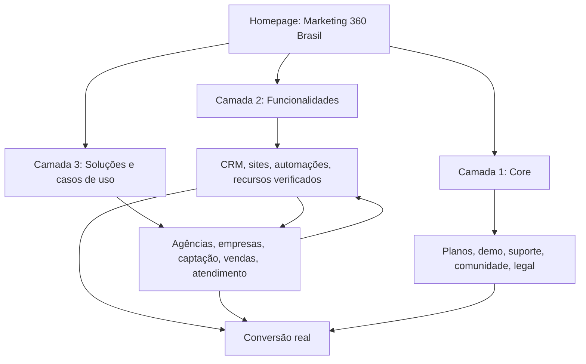

# Blueprint Smartsite — graao

**Uma pergunta. Uma solução. Um mercado. Uma conversão.**

O hub fortalece a entidade e responde a pergunta central. Spokes por recurso e caso de uso aprofundam a mesma oferta. Não há páginas de localidade, matrizes artificiais nem quantidade mínima de URLs. Toda página exige intenção distinta, evidência, links e próximo passo. O inventário proposto em docs/04-sitemap.md deve ser auditado antes da implementação/publicação.
