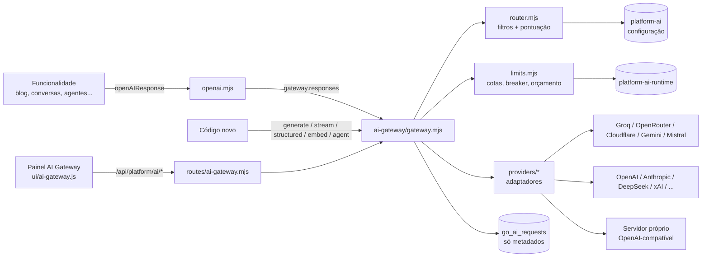

# graao AI Gateway

Camada central de IA da graao. Toda chamada de IA passa por um único ponto, que escolhe o provedor e o modelo,
tenta de novo quando falha, controla cotas e orçamento, registra custo e uso e aplica as regras de privacidade.

**Para quem usa a graao, nada muda por padrão.** A configuração inicial deixa todos os provedores desligados,
não autoriza nada pago e mantém o comportamento de hoje: cada agência usa a própria chave da OpenAI, com o
mesmo corpo de requisição e as mesmas mensagens de erro. O gateway entra no caminho como observador (log,
kill switch, circuit breaker, nova tentativa em falha passageira) e só passa a escolher modelos quando o dono
da plataforma liga provedores no painel **Plataforma → AI Gateway**.

## Sumário

1. [Arquitetura](#arquitetura)
2. [Instalação e ativação](#instalação-e-ativação)
3. [Variáveis de ambiente](#variáveis-de-ambiente)
4. [Provedores](#provedores)
5. [Registro de modelos e gratuidade](#registro-de-modelos-e-gratuidade)
6. [Roteamento](#roteamento)
7. [Falhas, fallback e streaming](#falhas-fallback-e-streaming)
8. [Custos, orçamento e planos](#custos-orçamento-e-planos)
9. [Segurança e privacidade](#segurança-e-privacidade)
10. [Integrar uma funcionalidade](#integrar-uma-funcionalidade)
11. [Adicionar um adaptador](#adicionar-um-adaptador)
12. [Testes](#testes)
13. [Solução de problemas](#solução-de-problemas)
14. [Limitações conhecidas e próximos passos](#limitações-conhecidas-e-próximos-passos)
15. [Rollback](#rollback)
16. [Checklist de produção](#checklist-de-produção)

## Arquitetura



| Arquivo | Papel |
| --- | --- |
| `ai-gateway/gateway.mjs` | `createGraaoAI()`: API interna (`generate`, `stream`, `structured`, `embed`, `agent`, `responses`) e funções do painel (`admin.*`). Laço de tentativas, reserva e conciliação. |
| `ai-gateway/contracts.mjs` | Formato único de pedido (`normalizeRequest`), modos, tarefas e capacidades; conversão de/para a Responses API. |
| `ai-gateway/router.mjs` | Filtros obrigatórios e pontuação ponderada. Função pura: não chama provedor. |
| `ai-gateway/limits.mjs` | Cotas por minuto, dia e mês, circuit breaker, concorrência, limite diário por organização e orçamento. |
| `ai-gateway/registry.mjs` | Registro de modelos: sincronização pela API, revisão do administrador, cadastro manual. |
| `ai-gateway/config.mjs` | Configuração padrão segura, funcionalidades (`FEATURES`), planos e validação do que o painel salva. |
| `ai-gateway/accounting.mjs` | Estimativa de tokens e custo em micro-dólar inteiro. |
| `ai-gateway/errors.mjs` | Classes de erro, classificação de HTTP e mensagens para o usuário final. |
| `ai-gateway/privacy.mjs` | Classes de dado (LGPD), travas de privacidade por provedor e `redact()`. |
| `ai-gateway/ssrf.mjs` | Validação de URL de servidor próprio. |
| `ai-gateway/cache.mjs`, `prompts.mjs`, `request-log.mjs` | Cache por organização, registro de prompts versionados, log de requisições. |
| `ai-gateway/providers/*` | Catálogo de provedores e adaptadores (OpenAI-compatível, Responses API, Anthropic). |
| `routes/ai-gateway.mjs` | Rotas do painel, só para o dono da plataforma (404 para os demais). |
| `ui/ai-gateway.js` | Tela do painel (abas Visão geral, Provedores, Modelos, Roteamento, Custos e planos, Prompts, Playground, Logs). |

Estado:

- **`platform-ai`** (documento em `go_workspaces`): configuração editada no painel (provedores, modelos, pesos,
  planos, orçamento, prompts, auditoria das alterações).
- **`platform-ai-runtime`** (documento em `go_workspaces`): estado de execução (saúde e circuit breaker, cotas,
  esperas, reservas de concorrência, orçamento gasto e reservado, contagem diária por organização, alertas).
  Toda alteração usa o compare-and-swap por revisão que o store já tem, então reservas concorrentes não
  estouram limites.
- **`go_ai_requests`** (tabela nova, Supabase ou SQLite local): uma linha por requisição, **só metadados**
  (funcionalidade, organização, modelo, status, tentativas, tokens, custo, latência). Nunca guarda prompt nem
  resposta. Linhas são imutáveis (gatilho recusa `update`); retenção de 180 dias pelo cron.

Integração com o que já existia:

- `openai.mjs` continua sendo a porta das funcionalidades. Com a chave da agência, `openAIResponse` chama
  `gateway.responses()`, que envia **o mesmo corpo** para `https://api.openai.com/v1/responses` (com
  `store: false`, como antes) e devolve a mesma resposta. Erros voltam com as mesmas mensagens de antes
  (`legacyError`).
- O consumo de cada subconta continua indo para o ledger e a carteira que já existiam (`usageMeter`,
  `recordAiUsage`, `checkAiBudget`). O gateway não cria outro sistema de créditos.
- Reuniões (transcrição) e visibilidade em buscas sempre pedem a chave da agência: dependem de recursos só da OpenAI.

## Instalação e ativação

1. **Banco (Supabase).** Rode, no SQL Editor, `supabase/migrations/20261126150000_go_ai_requests.sql` e depois o
   trecho novo do fim de `supabase/provision-storage.sql` (permissões e políticas RLS de `go_ai_requests`, com a
   mesma checagem de hash do `X-Go-Storage-Key` das outras tabelas). A migração é aditiva. Sem a tabela, o
   gateway funciona e o painel avisa que o log está indisponível.
2. **Chaves.** Na Vercel, cadastre só as variáveis dos provedores que vai usar (lista abaixo). Nenhuma é obrigatória.
3. **Painel.** Entre como dono da plataforma (`GO_AGENCY_OWNER_ID`) e abra **AI Gateway** no rodapé do menu.
   - Em **Provedores**, clique em *Testar conexão* e *Sincronizar modelos*.
   - Em *Regras deste provedor*, marque *Ligado*, confirme se a conta está no plano gratuito, se os termos
     permitem uso comercial e revise a privacidade (o que o provedor faz com os dados).
   - Em **Modelos**, revise os modelos: preço, gratuidade, capacidades e qualidade.
   - Em **Roteamento**, decida se agências sem chave da OpenAI usam a IA gratuita da graao (padrão: não).
   - Em **Custos e planos**, defina um orçamento mensal e diário **só se** quiser permitir chamadas pagas.
4. **Teste.** Use o **Playground** (chamada real, conta na cota) e *Simular falha* (sem chamar provedor).

## Variáveis de ambiente

| Variável | Provedor | Observação |
| --- | --- | --- |
| `GROQ_API_KEY` | Groq | Camada gratuita com limites por minuto e por dia. |
| `OPENROUTER_API_KEY` | OpenRouter | Modelos com preço zero na API são marcados grátis automaticamente. |
| `CLOUDFLARE_AI_API_TOKEN` e `CLOUDFLARE_ACCOUNT_ID` | Cloudflare Workers AI | Sem listagem pela API compatível: cadastre os modelos à mão. |
| `GEMINI_API_KEY` | Google Gemini | Também usada hoje pelo "Pergunte à Graao". |
| `MISTRAL_API_KEY` | Mistral AI | |
| `OPENAI_API_KEY` | OpenAI (conta da graao) | Também usada hoje pelo "Pergunte à Graao" e pela página Plataforma. Não é a chave das agências. |
| `ANTHROPIC_API_KEY`, `DEEPSEEK_API_KEY`, `XAI_API_KEY`, `TOGETHER_API_KEY`, `FIREWORKS_API_KEY`, `CEREBRAS_API_KEY` | Pagos | Só entram na rota com orçamento e liberação explícita. |
| `GRAAO_AI_COMPAT_BASE_URL` e `GRAAO_AI_COMPAT_API_KEY` | Servidor próprio | URL `https` pública (validação contra SSRF a cada 5 minutos). Chave opcional. |

As chaves vivem só no ambiente. Nenhuma rota recebe, guarda ou devolve chave; o painel mostra se a variável
existe e os 4 últimos caracteres.

## Provedores

| Id | Grupo | Adaptador | Modelos pela API | Notas |
| --- | --- | --- | --- | --- |
| `groq` | A | OpenAI-compatível | sim | Cabeçalhos `x-ratelimit-*`: requisições por dia, tokens por minuto; `retry-after` no 429. |
| `openrouter` | A | OpenAI-compatível | sim, com preço | `GET /api/v1/models` traz preço por token, contexto e parâmetros; `GET /api/v1/key` traz o limite diário dos modelos grátis. |
| `cloudflare` | A | OpenAI-compatível | não | `https://api.cloudflare.com/client/v4/accounts/{id}/ai/v1`. 10.000 Neurons grátis por dia; acima disso, US$ 0,011 por 1.000 Neurons (conferido em 26/11/2026). |
| `gemini` | A | OpenAI-compatível | sim | `https://generativelanguage.googleapis.com/v1beta/openai`. Na camada gratuita o Google pode usar os dados para melhorar produtos: a trava de privacidade limita a dado público ou interno. |
| `mistral` | A | OpenAI-compatível | sim | `https://api.mistral.ai/v1`. |
| `openai` | B | Responses API | sim | Também o caminho da chave própria (BYOK) das agências. |
| `anthropic` | B | Messages API | sim | JSON estruturado por ferramenta forçada. |
| `deepseek`, `xai`, `together`, `fireworks`, `cerebras` | B | OpenAI-compatível | sim | Preço precisa ser informado no painel antes de qualquer uso pago. |
| `compat` | C | OpenAI-compatível | sim | Servidor próprio. |

Preços e limites mudam. O gateway **não inventa preço**: modelo sem preço conhecido nunca é usado como pago.

## Registro de modelos e gratuidade

- *Sincronizar modelos* lê a lista oficial do provedor. Modelos novos entram ligados, mas um modelo sem preço
  conhecido e sem gratuidade confirmada nunca é escolhido (aparece como "Preço desconhecido" até a revisão).
  Modelos que sumiram da lista ficam **inativos** (os cadastrados à mão não).
- O que o administrador revisou (qualidade, capacidades, preço, ligado/desligado) sobrevive à sincronização.
- **Gratuidade nunca vem do nome do modelo.** Um modelo é grátis para a graao só quando:
  - a API do provedor informa preço zero (OpenRouter), ou
  - o administrador confirmou que a conta da graao está no plano gratuito do provedor **e** marcou o modelo como
    incluído nesse plano.
- Preço é guardado em micro-dólar por milhão de tokens (inteiro). Exemplo: US$ 2,50 por milhão = `2_500_000`.

## Roteamento

O roteador recebe o pedido normalizado e devolve candidatos ordenados e os descartados com o motivo.

**Filtros obrigatórios** (qualquer um descarta o modelo): credencial presente; provedor e modelo ligados e
ativos; capacidades pedidas (ferramentas, visão, JSON, embeddings, busca); modo permitido no plano; janela de
contexto (modelo sem janela conhecida aceita até 8.000 tokens); classe de dado permitida pela privacidade do
provedor; uso comercial confirmado; para pago: preço conhecido, modo que aceita pago, kill switch de pago
desligado, provedor com pago liberado e plano ou funcionalidade autorizando pago; circuit breaker; cotas.

**Pontuação** (pesos configuráveis em Roteamento, normalizados para somar 1):

| Critério | Peso padrão |
| --- | --- |
| Custo | 30% |
| Qualidade (definida por modelo no painel) | 25% |
| Disponibilidade (taxa de sucesso observada) | 20% |
| Velocidade (latência observada) | 15% |
| Capacidade restante (cotas) | 10% |

Depois da nota, a ordem é por faixa: chave própria da organização (quando existe), depois **gratuitos na
ordem do free-first** (Groq, OpenRouter, Cloudflare, Gemini, Mistral, configurável), depois pagos.

**Modos:** `auto` (equilíbrio), `free` (só gratuito ou chave própria), `fast` (velocidade), `pro` (qualidade),
`reason` (raciocínio), `vision` (imagem), `agent` (ferramentas), `embeddings`. O plano Free aceita `auto`,
`free`, `fast` e `embeddings`.

## Falhas, fallback e streaming

| Falha | O que o gateway faz |
| --- | --- |
| Rate limit (429) | Põe o modelo em espera pelo `retry-after` e tenta o próximo provedor. |
| Cota esgotada (402, 429 com "quota"/"daily") | Marca a cota e tenta o próximo provedor. |
| Timeout, 5xx, sobrecarga | Repete uma vez no mesmo provedor (backoff exponencial com jitter, ou `retry-after`), depois troca. |
| Chave recusada (401/403) | Não repete; troca de provedor e conta para o circuit breaker. |
| Modelo descontinuado | Troca de modelo. |
| Contexto excedido | Troca para modelo com janela maior. |
| Política de conteúdo, pedido inválido, cancelamento | Não troca: o erro volta para quem pediu. |
| JSON estruturado inválido | Tenta outro modelo uma vez; se falhar de novo, devolve erro. |

- **Circuit breaker:** depois de N falhas seguidas (padrão 5) o provedor fica em pausa (padrão 60 s). Depois
  da pausa, uma chamada de teste decide se volta. O painel tem *Tirar da pausa*.
- **Prazos:** por tentativa (45 s) e total (90 s), configuráveis.
- **Streaming:** se o provedor cair **antes** do primeiro texto, o gateway troca de provedor. Depois que o
  texto começou a sair, **nunca** recomeça em outro (o usuário veria duas respostas): o erro volta para quem pediu.

## Custos, orçamento e planos

- Dinheiro é sempre **micro-dólar inteiro** (1 US$ = 1.000.000). O custo arredonda para cima, nunca para zero.
- Antes de chamar um modelo pago, o gateway **reserva** o pior caso (tokens de entrada estimados + máximo de
  saída) no documento de execução, de forma atômica. Duas chamadas simultâneas não passam do orçamento. Depois
  da resposta, a reserva é trocada pelo custo real (uso informado pelo provedor; estimado quando não informado).
- **Sem orçamento mensal e diário, nada pago acontece.** Também há limite por organização, por funcionalidade
  e por provedor.
- Planos técnicos de IA (não mexem em preço nem assinatura): **Free**, **Pago** e **Chave própria**, cada um
  com requisições por dia por organização, máximo de tokens de entrada e saída, concorrência e se aceita
  fallback pago.
- **Idempotência:** pedidos com `idempotencyKey` iguais (mesma organização) devolvem o mesmo resultado sem nova chamada.
- **Cache:** só pedidos marcados `cache: true`, sem ferramentas, sem streaming e com temperatura 0. A chave
  inclui a organização: nada é compartilhado entre organizações.
- O consumo das subcontas continua no ledger e na carteira existentes; o gasto pago **da graao** (conta da
  plataforma) fica no documento de execução e aparece no painel.

## Segurança e privacidade

- **Credenciais:** só em variáveis de ambiente. Nunca no banco, no painel, em log ou em resposta. Erros de
  provedor passam por `redact()` antes de qualquer registro.
- **SSRF:** servidor próprio só com `https`, porta 443 ou 8443, sem usuário, senha, parâmetros ou âncora. O nome
  é resolvido no DNS e **todos** os endereços precisam ser públicos (bloqueia rede privada, loopback, link-local
  e metadados de nuvem). Redirecionamentos são recusados em toda chamada a provedor.
- **Classes de dado (LGPD):** `public`, `internal`, `confidential`, `personal`, `sensitive`, `restricted`. Cada
  funcionalidade tem uma classe (ex.: conversas com clientes são `confidential`). Cada provedor tem uma classe
  máxima com travas: sem revisão dos termos, no máximo `internal`; se o provedor usa os dados para treino, no
  máximo `internal`; `restricted` exige DPA e retenção zero. **Por isso, ao ligar um provedor, as funcionalidades
  com dado confidencial só passam a usá-lo depois que você revisar a privacidade dele no painel.**
- **Log:** só metadados; usuário guardado como hash curto. Retenção de 180 dias. Linhas imutáveis.
- **Agentes:** ferramenta sem a permissão do usuário no contexto não roda; ferramenta com efeito externo
  (`sideEffect`) só roda com aprovação humana (`approve`); a mesma chamada (nome + argumentos) nunca roda duas
  vezes; há limite de passos e de custo.
- **Painel:** rotas existem só para o dono da plataforma; para os demais respondem 404. Toda alteração entra na
  auditoria (quem, quando, o quê).

Isto é uma base técnica de proteção de dados. Não substitui análise jurídica nem garante conformidade total com a LGPD.

## Integrar uma funcionalidade

As funcionalidades atuais já passam pelo gateway via `openAIResponse` (nada a fazer). Para código novo, use a
instância criada em `server.mjs` (`graaoAI`):

```js
// Texto
const result = await graaoAI.generate(
  { feature: 'content.writer', messages: [{ role: 'user', content: 'Escreva um título para…' }], maxOutputTokens: 300 },
  { org: subaccountId, user: session.id, plan: 'paid', onUsage: usage => meter.record(usage) }
);
result.text; result.costMicros; result.modelKey; result.tier; // 'free' | 'paid' | 'byok'

// JSON validado contra o schema
const { json } = await graaoAI.structured({ feature: 'workflow.ai', messages, schema: { name: 'acao', schema: { type: 'object', properties: { tipo: { type: 'string' } }, required: ['tipo'] } } }, ctx);

// Streaming
for await (const event of graaoAI.stream({ feature: 'graao.chat', messages }, ctx, { signal })) {
  if (event.type === 'delta') res.write(event.text);
  if (event.type === 'done') console.log(event.result.usage);
}

// Embeddings
const { vectors } = await graaoAI.embed({ feature: 'content.writer', input: ['texto 1', 'texto 2'] }, ctx);

// Agente com ferramentas e aprovação humana
const out = await graaoAI.agent({ feature: 'agent.reply', messages, tools: [
  { name: 'buscar_contato', description: '…', parameters: { type: 'object', properties: { q: { type: 'string' } } }, handler: args => buscar(args.q) },
  { name: 'enviar_email', description: '…', parameters: {…}, sideEffect: true, permission: 'email.send', handler: args => enviar(args) }
] }, { ...ctx, permissions: ['email.send'] }, { approve: async call => perguntarAoUsuario(call), maxSteps: 6 });
if (out.pendingApproval) { /* mostrar ao usuário e chamar de novo depois do sim */ }
```

Regras: a organização (`org`) sempre vem do servidor, nunca do pedido. Para uma funcionalidade nova, cadastre o
id em `FEATURES` (`ai-gateway/config.mjs`) com a classe de dado certa. Erros são `GatewayError` com `kind` e uma
mensagem pronta para o usuário final (`error.message`); o detalhe técnico fica em `error.internal`, que nunca
deve ir para o cliente.

## Adicionar um adaptador

1. Se o provedor fala a API da OpenAI (`/chat/completions`), basta uma linha em `ai-gateway/providers/catalog.mjs`
   (`adapter: 'openai-compatible'`, `baseUrl`, `keyEnv`, `sync`).
2. Se não, crie `ai-gateway/providers/<nome>.mjs` com `generateText`, `streamText`, `listModels`, `checkHealth`
   e, se houver, `generateEmbeddings` e `accountQuota`, devolvendo o mesmo formato dos outros adaptadores
   (`{ text, toolCalls, finishReason, usage, model, rateLimit }`). Use `send()` de `providers/http.mjs`: ele já
   aplica prazo, recusa redirecionamento e classifica erros. Registre em `providers/index.mjs`.
3. Escreva testes com fetch falso em `test/ai-gateway.test.mjs`.

## Testes

`test/ai-gateway.test.mjs` (28 testes, todos com provedores **simulados** por fetch falso) cobre: free-first;
fallback em rate limit, cota, timeout, chave recusada e modelo removido; circuit breaker; contexto excedido;
nada pago sem orçamento; plano Free sem pago; preço desconhecido e nome com "free"; sincronização do OpenRouter;
reserva de orçamento concorrente e custo inteiro; idempotência; isolamento do cache entre organizações; kill
switch geral e de pago; streaming interrompido sem recomeço; JSON estruturado inválido; agente (repetição,
permissão, aprovação); falha do documento de cotas; privacidade e uso comercial; SSRF; servidor próprio com URL
privada; vazamento de chave; cabeçalhos de limite; dinheiro inteiro; log imutável; rotas 404; compatibilidade
com o caminho antigo da chave da agência.

Os testes provam a lógica do gateway. **Não provam** o comportamento real de cada provedor em produção (formatos,
limites e preços reais precisam ser conferidos com as chaves reais pelo Playground).

```bash
node --test test/ai-gateway.test.mjs
npm test
```

## Solução de problemas

| Sintoma | Causa provável |
| --- | --- |
| "Log de requisições indisponível" | A migração `go_ai_requests` ou as políticas do `provision-storage.sql` não foram aplicadas. |
| Provedor "Sem credencial" | Variável ausente no ambiente (ou deploy sem a variável). |
| Funcionalidade não usa o provedor ligado | Privacidade não revisada (dado confidencial), uso comercial não confirmado, modelo sem preço e sem gratuidade, ou modo fora do plano. Use *Simular roteamento*: ele lista o motivo de cada descarte. |
| "Nenhum modelo elegível" com orçamento | Pago não liberado no provedor, no plano ou na funcionalidade. |
| Provedor "Pausado" | Circuit breaker aberto por falhas seguidas. Veja o último erro no cartão e use *Tirar da pausa*. |
| Agência sem chave continua vendo o pedido de chave | Roteamento → "Agências sem chave da OpenAI" está em "Pedir a chave" (padrão), ou não há modelo gratuito elegível. |

## Limitações conhecidas e próximos passos

- **Concorrência no documento de execução:** todas as reservas disputam o mesmo documento (`platform-ai-runtime`)
  com compare-and-swap. Em volume alto, isso vira gargalo e gera repetições; o próximo passo é separar contadores
  por provedor ou mover para uma tabela com incremento atômico.
- **Cache e idempotência por instância:** na Vercel cada instância tem a própria memória. É ganho oportunista,
  não garantia. Idempotência entre instâncias exigiria uma tabela de chaves.
- **Créditos:** não há um ledger de créditos separado. O consumo das subcontas usa o ledger e a carteira
  existentes; o gasto da conta da graao fica no documento de execução. Um ledger de créditos por plano é o
  próximo passo natural se a graao passar a vender IA da plataforma.
- **Provedores reais:** os adaptadores seguem a documentação pública dos provedores, mas só foram exercitados com
  respostas simuladas. Antes de ligar cada um em produção, teste no Playground com a chave real.
- **Funcionalidades que ainda chamam a OpenAI fora do `openAIResponse`** (transcrição de reuniões, visibilidade
  em buscas, e o "Pergunte à Graao", que tem caminho próprio com `OPENAI_API_KEY`/`GEMINI_API_KEY`) não passam pelo
  gateway nesta entrega.

## Rollback

1. Código: reverter o PR. O caminho antigo (`openAIRequest` direto) volta sozinho, porque `openAIResponse` só usa
   o gateway quando ele é passado.
2. Sem reverter código: no painel, **Desligar todo o gateway** (kill switch) bloqueia as chamadas da plataforma; a
   chave da agência também passa pelo kill switch, então para desligar só os provedores novos, desligue cada
   provedor em vez disso.
3. Banco (opcional, só se quiser remover os dados):
   `drop table public.go_ai_requests cascade; drop function public.go_ai_requests_summary(timestamptz); drop function public.go_ai_requests_immutable();`
   e apague os documentos `platform-ai` e `platform-ai-runtime` de `go_workspaces`.

## Checklist de produção

- [ ] Migração `go_ai_requests` e políticas do `provision-storage.sql` aplicadas no Supabase.
- [ ] Variáveis dos provedores escolhidos cadastradas na Vercel (e nenhuma chave em arquivo versionado).
- [ ] Cada provedor ligado: conexão testada, modelos sincronizados, plano gratuito confirmado na conta,
      termos de uso comercial lidos, privacidade revisada.
- [ ] Preço conferido de todo modelo pago que puder ser usado.
- [ ] Orçamento mensal e diário definidos (ou zero, para não permitir pago).
- [ ] Playground com chamada real em cada provedor ligado; streaming testado.
- [ ] Decisão tomada sobre "Agências sem chave da OpenAI".
- [ ] Alertas acompanhados na Visão geral na primeira semana.
